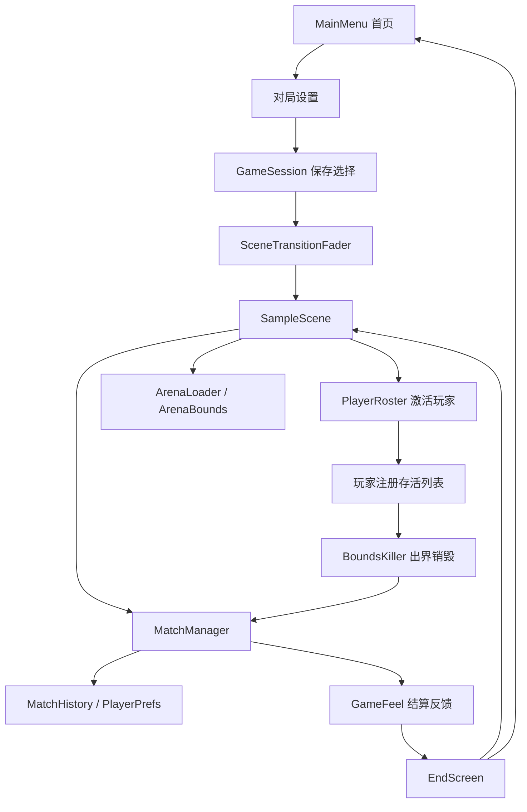

# 架构说明

核对日期：2026-10-26。本文描述当前本地工程，历史方案与当前行为不一致时，以实际代码、场景配置和本文为准。

## 技术与模块

Unity 6000.3.23f1，C#，2D Physics，URP 17.3.0，uGUI / TextMeshPro。运行时脚本集中于 `Assets/LogicScripts/`，编辑器工具位于 `Assets/Editor/`。当前没有自定义 asmdef，场景与 Inspector 引用承担模块装配，序列化字段承担大部分数值配置。

| 模块目录 | 职责与入口 |
|---|---|
| `Ball/` | `PlayerBase` 共享移动、状态与道具逻辑；三个 Controller 读取输入；`PlayerRoster` 激活人数；AI 追击／生成；出界销毁 |
| `Match/` | `GameSession` 跨场景配置；`MatchManager` 单局状态；`MatchHistory` 本机统计；状态轮盘 |
| `Arena/` | `ArenaBounds` 共享边界；`ArenaPreset` 地图数据；`ArenaLoader` 加载地图与障碍；`ArenaShrinker` 收缩 |
| `Buff/` | 道具生成、预告、拾取与视觉反馈 |
| `UI/` | 菜单、选择器、帮助、设置、战绩、HUD、暂停、结算与转场 |
| `Visual/` | 身份标识、危险提示、拖尾与 `GameFeel` 撞击／死亡反馈 |
| `Audio/` | `AudioManager` 管理 BGM、音效通道与音量 |
| `Demo/` | 空闲演示入口与演示覆盖逻辑 |

## 场景与数据流

`MainMenuController` 负责首页五入口与对局设置面板。人数、模式和难度选择器写入 `GameSession`，确认开局通过 `SceneTransitionFader` 加载 `SampleScene`。保留旧场景兼容分支：未接设置面板时，开始按钮直接开局。

`GameModeSelector` 支持按模式隐藏难度行，但当前场景的 `difficultyGroup` 未连接，不能假定 PvP 固定隐藏难度。人数选择也未被代码限制为仅 PvP 可用。

`GameSession.Ensure()` 按需创建 `DontDestroyOnLoad` 单例。转场组件也跨场景存在；`AudioManager` 在独立音频对象上时跨场景保留。暂停和最终结算冻结 `Time.timeScale`，重开与回菜单恢复时间倍率。

直接 Play `SampleScene` 时，缺少 `GameSession` 的模块使用默认值，不能代替从菜单进入的流程验收。

## 玩家、物理与状态

三个玩家 Controller 继承 `PlayerBase`，只区分编号和输入。`Update` 读取方向、更新道具计时，`FixedUpdate` 通过 `Vector2.MoveTowards` 将刚体速度逼近目标速度。输入仍使用 `UnityEngine.Input`，没有迁移成 Input Actions 驱动。

`BallState` 为互斥状态 Normal / Fast / Big / Small，轮盘只随机分发后三种。`PickupBuff` 使用位标记，可以与轮盘状态组合；`RecalcStats()` 从基础属性重新计算速度、加速度、质量和体积。重复拾取持续型道具刷新计时，冲击波即时触发。

无敌通过 Player / InvinciblePlayer 层碰撞矩阵及显式 `Physics2D.IgnoreCollision` 处理穿透。`BoundsKiller` 根据球心和缩放后的圆碰撞器半径判断整球是否越过任一边界；玩家与 AI 复用，无敌仍接受此检查。

## 对局生命周期

1. `MatchManager.Awake()` 清空存活列表，重置单局计时、结果和时间倍率。
2. 玩家 `Start()` 注册，`OnDestroy()` 注销并触发胜负检查。
3. PvP 剩一人判胜、剩零人判平；合作直到所有玩家淘汰才结束。
4. 保存本机结果，经 `GameFeel` 结算反馈后冻结时间，发出 `OnMatchEnded` 供 `EndScreen` 响应。

胜负检查由逐个销毁事件触发，首次结算后不再改判，因此不保证“同一帧多人出界必定平局”。生成器、轮盘与场地收缩检查暂停／结算状态。系统通过单例、共享存活列表和事件协作，没有统一事件总线或依赖注入框架。

## AI、道具与场地

`DifficultyProfile.Get()` 集中定义三档 AI 延迟、间隔、速度／质量倍率和合作节奏倍率。`AIController` 在物理帧追击最近存活玩家，不参与轮盘、不拾取道具。

合作模式约 1 秒后开始生成 AI，间隔每 30 秒减半，下限 1 秒，同屏上限 8；死亡后在后续生成时机补充。合作节奏倍率同时乘轮盘与道具间隔，倍率越小，切换和生成越频繁。

`BuffPickupSpawner` 在边界内选点，预告后生成五类道具，`BuffPickup` 仅接受带 `PlayerBase` 的对象。`ArenaBounds` 为出界判定、生成和危险提示共用边界；`ArenaShrinker` 更新该边界。

地图框架为 `ArenaPreset` ScriptableObject + `ArenaLoader`，通过 `GameSession.SelectedArena` 或 fallback 传递。当前菜单 `mapSelectController` 未连接，游戏场景 fallback 为空，`Assets/Resources/` 未发现地图预设。当前菜单不提供选图，地图框架不代表已有多张可玩地图。

## 持久化

| 数据 | 存放方式 |
|---|---|
| 模式、人数、难度、BGM / SFX 音量 | `GameSession` + `PlayerPrefs`，键前缀 `PPP_` |
| 当前地图、是否演示 | `GameSession` 内存状态 |
| PvP 总场次、各玩家胜场、平局 | `MatchHistory` 写入 `PlayerPrefs` |
| 合作最高存活时间 | 仅 Hard，按 2P / 3P 分开存储 |

战绩为累计统计和最佳成绩，不是逐局历史。当前无账号、联网同步或云存档。

## 编辑器与构建

- `BorderlessMainMenuLayout` 应用已确认布局，包含菜单流程核验逻辑。
- `BuildMainMenuScene` / `PatchSampleScene` / `SetupBuildScenes` 为早期场景生成与接线工具；旧菜单生成器会覆盖布局，日常调整优先修改现有场景。
- `TmpMigrator` 为文字组件迁移工具。
- `CompetitionReleaseBuilder` 监听 `Library/CompetitionReleaseBuild.request`，构建 Windows x86_64 并写结果 JSON。工具会退出 Play 模式，必要时保存当前主菜单场景，临时修改产品名后恢复。

构建请求含输出 exe 路径和 `sourceCommit`，提交号为请求元数据，不自动保证工作区与提交一致。`Library/` 记录和构建产物不入库，发布追溯需结合交付清单与实际校验。
